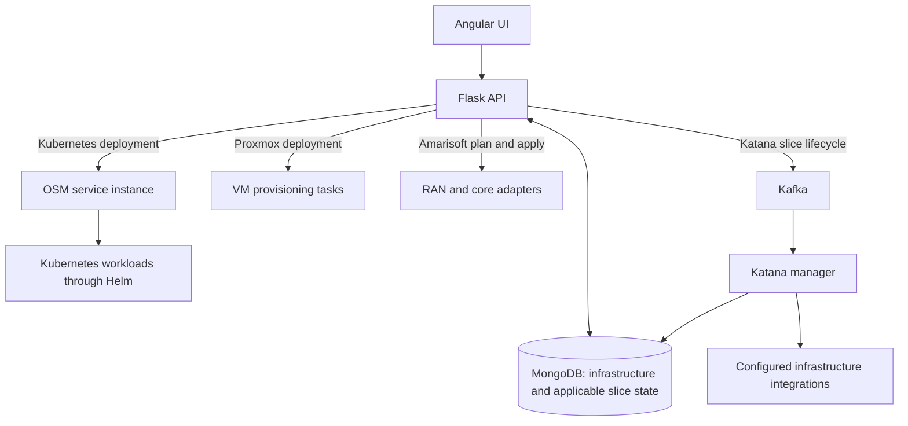

# Katana workflow: what happens, why, and how

Katana helps an operator prepare infrastructure, submit deployments, and inspect their results. The main objective is a working network slice. Creating a VM or receiving a successful API response is an intermediate step; service functionality needs separate verification.

This guide explains the application workflow first, followed by the debugging and lab-verification workflow. For recorded test results and runnable checks, see [Workflow verification](workflow-verification.md).

## 1. Understand the components

| Component | What it does | Why it is needed |
| --- | --- | --- |
| Angular frontend | Presents inventory, deployment forms, previews, status and history. | Gives the operator a guided way to configure and inspect work. |
| Flask backend / NBI | Validates requests and communicates with the appropriate infrastructure service. | Applies server-side rules and translates UI actions into infrastructure operations. |
| MongoDB | Stores registered infrastructure, relationships and applicable slice records/results. | Allows the backend to recover and report persisted state. |
| OSM | Orchestrates network services using their descriptors and deployment parameters. | Coordinates deployment onto the selected infrastructure. |
| Kubernetes and Helm | Run workloads and turn chart values into workload configuration. | Provide the execution environment for the Kubernetes deployment path. |
| Proxmox | Clones or creates VMs and runs provisioning tasks. | Provides VM infrastructure through the Proxmox deployment option. |
| Amarisoft adapters | Apply slice configuration to RAN and core targets. | Translate the slice request into target-specific operations. |
| Kafka and Katana manager | Queue and execute Katana slice lifecycle operations. | Separate API requests from longer-running slice management work. |

The deployment paths use different components:

Direct Kubernetes deployment creates an **OSM service instance**. Existing Katana slice-status pages use a **Katana slice ID**. These IDs and their lifecycle actions are not interchangeable. The Kubernetes, Proxmox and Amarisoft deployment paths do not all pass through Kafka or the manager.

## 2. Prepare infrastructure and deployment packages

**What:** Establish the infrastructure registrations, credentials, relationships and packages that a deployment needs.

**Why:** A deployment must identify a reachable target and a compatible package before it can create resources.

**How:**

1. Use **Time-0 Setup** to reconcile NFVOs, VIMs and their links where required. An NFVO is the orchestrator; a VIM manages infrastructure resources.
2. Use **Infrastructure** to review registered resources and repair a missing Kubernetes cluster location without registering the cluster again.
3. For Kubernetes deployment, register a new cluster with credentials or reuse an existing registration.
4. Use **Helm Charts** to sign in, upload a valid chart package and inspect its versions. The corresponding service descriptors must also be available in OSM; uploading a Helm chart alone does not onboard those descriptors.
5. For Proxmox, connect to the cluster and discover its datacenter, servers, storage and deployment sources. For Amarisoft, identify the RAN and core targets.

Dashboard inventory helps review these resources. A failure in one inventory source should remain visible without hiding healthy sections.

## 3. Choose and configure a deployment

Open **Deployments → New Deployment**, then select a deployment type.

### Kubernetes / NEST

**What:** Request an OSM network-service deployment on registered Kubernetes infrastructure, optionally using a NEST file.

**Why:** Reuse an onboarded service package while supplying the supported configuration for this deployment.

**How:** Select the NSD (network-service descriptor), its NFVO and the appropriate VIM account/cluster. Upload the optional NEST, inspect the generated Helm values, and submit. Flask validates the selection and supported configuration before sending the request to OSM.

The current free5GC NEST profile changes the supported SD value across core, RAN, UE and subscriber configuration. SD values such as `000002` remain six-character strings. This profile does not implement every NEST field or guarantee QoS or resource isolation. See [NEST-driven deployment](nest-helm-configuration.md) for its exact scope.

### Proxmox

**What:** Provision VMs by cloning a source VM/template or creating a new VM with an ISO attached.

**Why:** Prepare VM resources for the intended workload.

**How:** Connect or revalidate a saved registration, select the server and storage, review available capacity, and configure CPU, memory, disk and networking. The backend validates the VM definitions, submits provisioning operations and waits for Proxmox tasks. The UI then attempts bounded guest-IP discovery for started VMs.

An ISO-based VM may still need operating-system installation. A provisioned VM or discovered IP does not prove guest connectivity or a functioning network slice. **New Deployment → Proxmox remains supported; the separate Proxmox monitoring sidebar page is removed.**

### Amarisoft

**What:** Preview a slice configuration, save it as a plan, then apply it to RAN and core targets.

**Why:** Let the operator inspect the intended configuration before changing the targets, and retain results for recovery.

**How:** Enter slice identity, PLMN, DNN, QoS, subscriber information and targets. Preview constructs the proposed payload without saving or applying it. Saving creates a planned record. Applying calls the target adapters and persists their results. Partial failures remain visible; a failed target deletion retains the recovery record.

## 4. Follow the operation and verify its outcome

**What:** Track progress and establish what has actually completed.

**Why:** Acceptance, provisioning and a working service are different outcomes.

| Level | Meaning | Evidence to inspect |
| --- | --- | --- |
| Request accepted | The receiving system accepted the request. | API response and returned identifiers. |
| Operation completed | The requested orchestration or provisioning operation finished. | OSM operation, Proxmox task or adapter result. |
| Workload ready | The deployed components are healthy enough to operate. | Kubernetes readiness, VM startup or target health. |
| Service verified | The intended service works. | For a network slice: UE registration, PDU session and traffic. For VM provisioning: expected guest connectivity. |

For existing Katana slices, the status page polls for stages and exposes applicable lifecycle actions, errors and logs. Polling is bounded: stopping polling does not cancel the underlying operation or prove that it failed.

For direct Kubernetes deployments, inspect OSM and Kubernetes using the returned OSM information. Do not substitute an OSM ID into a Katana slice-status URL. Where slice monitoring is configured, use **Monitoring** to inspect summaries, metric ranges, logs and monitoring links.

## 5. Keep history and recover deliberately

**What:** Retain useful configuration and results so an operator can review or retry work.

**Why:** Refreshes, failed requests and partial deployments should not force the operator to guess what happened.

**How:** Drafts and deployment history store redacted browser-side data. Accepted Kubernetes requests retain their OSM response and are labelled as unverified for readiness. Reopening a pack restores configuration but requires prerequisites to be revalidated. NEST contents must be uploaded again after refresh where required.

If browser storage is unavailable, the UI keeps data in memory and warns that it will be lost on reload. Clearing History removes browser records; it does not delete infrastructure. Before retrying a timed-out remote write, inspect the external system because the original operation may already have created resources.

## 6. Debug and verify locally before using the lab

**What:** Check each feature from the UI action through its backend path and displayed result.

**Why:** Find application defects without depending on live infrastructure or creating lab resources.

**How:**

1. Record the branch, existing changes, dependency versions and baseline failures.
2. Trace the actual request path, including persistence or messaging only where used.
3. Exercise valid input, invalid input, empty data, authentication/dependency failures, repeated submissions, refresh and recovery as applicable.
4. Reproduce a defect, fix its shared root cause, and leave a focused regression check.
5. Run the Angular and Python suites, production build, Helm lint and NEST chart-rendering check.
6. Exercise persistence and messaging in disposable local services; simulate external deployment integrations at their boundaries.
7. Walk through the production UI in a browser, including keyboard interaction and narrow layouts.

This local phase has been completed for the checks recorded in the [verification report](workflow-verification.md). Simulated integrations and local service tests do not certify a live deployment.

## 7. Verify against designated lab targets — the next phase

**What:** Prove that the application works with the actual deployment environment.

**Why:** Local tests cannot prove infrastructure compatibility, real task completion, radio registration or traffic flow.

**How:**

1. **Record the test environment.** Specify approved endpoints, versions, credential references, resource limits, disposable targets and unique test names. Record configuration that may need restoration.
2. **Check prerequisites.** Confirm connectivity, permissions, package compatibility and available capacity on the designated targets.
3. **Deploy sequentially.** Use identifiable test resources and capture redacted requests, operation/resource IDs, logs and persisted results.
4. **Check infrastructure results.** Confirm actual configuration, orchestration/task completion and workload or VM health.
5. **Check service functionality.** For a network slice, confirm UE registration, establish a PDU session, then send basic traffic to the designated destination. Verify VM connectivity separately for Proxmox provisioning.
6. **Check a second SD.** Clean up the first deployment or use an isolated environment. Repeat with a different SD and verify the requested configuration throughout. Do not assume simultaneous deployments are isolated.
7. **Recover and clean up.** Inspect partial or ambiguous outcomes before retrying. Remove only resources created by the test and restore recorded configuration changes.
8. **Record the result per feature.** Mark it local passed, lab passed, blocked or failed, with evidence and remaining limitations.

Lab verification remains pending until the disposable targets are designated. The endpoint and target checklist is in [Pending lab acceptance](workflow-verification.md#pending-lab-acceptance).
